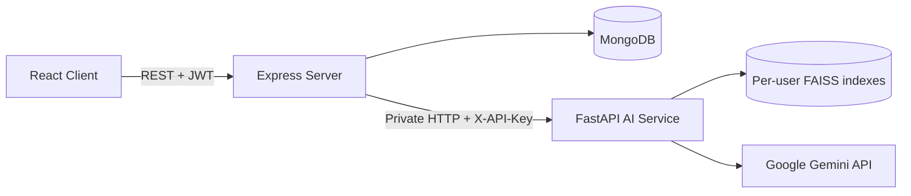

<div align="center">

# DevDocs AI

**Upload technical PDFs. Ask questions. Get answers grounded in your documents.**


[Live Demo](https://dev-docs-ai-five.vercel.app/login) · [Report a Bug](https://github.com/arka562/DevDocsAI/issues)

<br />


</div>

---

## Overview

DevDocs AI is a Retrieval-Augmented Generation (RAG) application for asking questions about developer documentation and technical PDFs. It extracts text from uploaded PDFs, splits it into overlapping chunks, embeds those chunks, and retrieves relevant passages to ground answers in the uploaded material.

### How it works

1. Sign in and upload a PDF.
2. The Express API records the document and forwards it to the private FastAPI service.
3. The AI service extracts page text, creates chunks and embeddings, and stores them in a per-user FAISS index.
4. Ask a question in chat. The service retrieves relevant chunks and generates an answer with source metadata, including document and page information where available.

The browser communicates with Express. The AI service is intended to be called by the server and protects its `/ai/*` endpoints with a shared `INTERNAL_API_KEY`.

---

## Features

| Feature | Details |
|---|---|
| Authentication | JWT-based registration/login and bcrypt password hashing |
| PDF ingestion | PDF text extraction, cleaning, overlapping chunks, and embeddings |
| Semantic retrieval | FAISS vector search over the current user's index |
| RAG chat | Answers generated from retrieved document context, with recent conversation history |
| Source citations | Retrieved source information, including document IDs and page numbers |
| Conversation history | Saved conversations and messages |
| Processing status | Documents report processing, completed, or failed status |
| Dashboard | Document and chat activity summaries |
| Rich answers | Markdown rendering and formatted code in the client |

---

## Architecture



### Ingestion flow

```text
PDF upload -> bounded file read -> PDF text extraction -> clean and chunk by page
           -> embeddings -> FAISS index + chunk metadata
```

### Question flow

```text
Question -> query embedding -> top-k vector retrieval
         -> retrieved context + recent history -> LLM answer + sources
```

---

## Tech stack

| Layer | Tools |
|---|---|
| Frontend | React 19, Vite, Tailwind CSS, React Router, Axios, react-markdown |
| Backend | Node.js, Express 5, Mongoose, JWT, bcrypt, Multer |
| AI service | Python, FastAPI, pypdf, FAISS, Google Gemini |
| Database | MongoDB |
| Retrieval | FAISS vector index with per-user files and document-level metadata |

---

## Getting started

### Prerequisites

- Node.js 18 or newer
- Python 3.10 or newer
- MongoDB locally or through MongoDB Atlas
- A Google Gemini API key with access to the configured embedding and generation models

### 1. Clone the repository

```bash
git clone https://github.com/arka562/DevDocsAI.git
cd DevDocsAI
```

### 2. Configure and run the AI service

Open a terminal:

```bash
cd ai_service
python -m venv venv
```

Activate the virtual environment:

```bash
# Windows PowerShell
.\venv\Scripts\Activate.ps1

# macOS / Linux
source venv/bin/activate
```

Install dependencies and configure the environment:

```bash
pip install -r requirements.txt
# Copy .env.example to .env, then edit .env
```

Set at least these values in `ai_service/.env`:

- `LLM_API_KEY`: your Gemini API key
- `INTERNAL_API_KEY`: a long, random secret shared with the Express server
- `FRONTEND_URL`: the exact browser origin(s), comma-separated if more than one
- `MAX_UPLOAD_BYTES`: maximum accepted PDF size in bytes (default: 20 MiB)

Start the service from the `ai_service` directory:

```bash
uvicorn app.main:app --reload --port 8000
```

### 3. Configure and run the Express server

In a second terminal:

```bash
cd server
npm install
```

Copy `server/.env.example` to `server/.env` and set:

- `MONGO_URI`: your MongoDB connection string
- `JWT_SECRET`: a long, random secret used to sign JWTs
- `INTERNAL_API_KEY`: exactly the same secret as `ai_service/.env`
- `AI_SERVICE_URL`: AI service URL (local default: `http://localhost:8000`)

Start the server:

```bash
npm run dev
```

### 4. Run the client

In a third terminal:

```bash
cd client
npm install
npm run dev
```

Open the Vite URL printed in the terminal (normally `http://localhost:5173`), register, upload a PDF, wait for processing to finish, and ask a question in Chat.

> **Important:** Never commit real `.env` files or API keys. Generate a long random `INTERNAL_API_KEY` and configure the same value in the server and AI-service environments. Do not use a public or predictable default secret in production. Set `FRONTEND_URL` to your actual deployed frontend origin; do not use `*` with credentialed CORS.

---

## Environment variables

| Variable | Service | Purpose |
|---|---|---|
| `LLM_API_KEY` | AI service | Gemini API key for generation/embeddings |
| `INTERNAL_API_KEY` | Both | Shared secret for Express-to-FastAPI requests; required |
| `FRONTEND_URL` | AI service | Allowed frontend origin(s), comma-separated |
| `MAX_UPLOAD_BYTES` | AI service | PDF size limit in bytes; defaults to 20 MiB |
| `EMBEDDING_MODEL` | AI service | Embedding model setting used by the project |
| `VECTOR_DB_PATH` | AI service | Legacy/configurable vector storage path; verify against deployment setup |
| `PORT` | Express server | API port; defaults to 5000 |
| `MONGO_URI` | Express server | MongoDB connection string |
| `JWT_SECRET` | Express server | JWT signing secret |
| `AI_SERVICE_URL` | Express server | Base URL of the FastAPI service |

---

## API reference

All Express routes are mounted under `/api`. Private Express routes require a valid JWT.

### Express API

| Method | Endpoint | Description |
|---|---|---|
| POST | `/api/auth/register` | Create an account |
| POST | `/api/auth/login` | Log in and receive a token |
| GET | `/api/auth/me` | Get the current user |
| GET | `/api/documents` | List the current user's documents |
| POST | `/api/documents/upload` | Upload a PDF |
| GET | `/api/documents/:id` | Get one owned document |
| DELETE | `/api/documents/:id` | Delete an owned document and its indexed chunks |
| GET / POST | `/api/chat/conversations` | List or create conversations |
| GET / DELETE | `/api/chat/conversations/:id` | Read or delete a conversation |
| POST | `/api/chat/conversations/:id/messages` | Ask a question and save the answer |
| GET | `/api/stats` | Get dashboard statistics |

### Internal FastAPI API

These endpoints are protected by `X-API-Key` and should not be exposed as a public client API.

| Method | Endpoint | Description |
|---|---|---|
| POST | `/ai/process-document` | Extract, chunk, embed, and index a PDF |
| POST | `/ai/retrieve` | Retrieve matching chunks |
| POST | `/ai/chat` | Generate a RAG answer |
| POST | `/ai/delete-document` | Remove chunks associated with a document |

---

## Project structure

```text
DevDocsAI/
├── client/                 # React frontend
├── server/                 # Express API, auth, MongoDB models and controllers
│   ├── controllers/
│   ├── models/
│   ├── routes/
│   └── middleware/
└── ai_service/             # FastAPI RAG pipeline
    └── app/
        ├── routes/
        └── services/       # PDF processing, chunking, embeddings, vector store, RAG
```

---

## Security and operational notes

- FastAPI rejects requests to `/ai/*` when `INTERNAL_API_KEY` is missing or invalid.
- The internal key has no built-in fallback. Configure it in both services.
- User and document identifiers are validated as MongoDB ObjectId-shaped values before vector-store access.
- The AI service enforces its own PDF upload size limit (default 20 MiB); configure the upstream Express upload middleware to use a compatible limit too.
- FAISS data is persisted as local files. A single-process lock protects operations within one Python process, but it is not a distributed lock; multi-worker or multi-instance deployments need shared storage and cross-process coordination.
- Deletion spans FAISS, the uploaded file, and MongoDB. A process crash between these steps can leave inconsistent state; production deployments should add a retryable deletion job or reconciliation task.
- The repository's configured deployment, environment values, and external services must be verified separately before treating a deployment as production-ready.

---

## Known limitations

- Responses are not streamed.
- Chunking is based on word count rather than a model tokenizer.
- No reranking or hybrid search is implemented.
- Local FAISS files are not a shared/distributed vector database.

## Roadmap

- [x] Per-user vector isolation
- [x] Document-specific chunk deletion
- [x] Page metadata in retrieved sources
- [x] Environment-based AI service URL
- [x] Require a configured internal API key
- [x] Validate vector-store user/document IDs
- [x] Enforce a FastAPI PDF upload limit
- [ ] Streaming responses
- [ ] Semantic chunking
- [ ] Retryable deletion/reconciliation workflow
- [ ] Automated tests for authorization, tenant isolation, upload limits, and deletion consistency

---

## Author

**Arkaprava Ghosh**

- GitHub: [arka562](https://github.com/arka562)
- Issues and bug reports: [GitHub Issues](https://github.com/arka562/DevDocsAI/issues)
